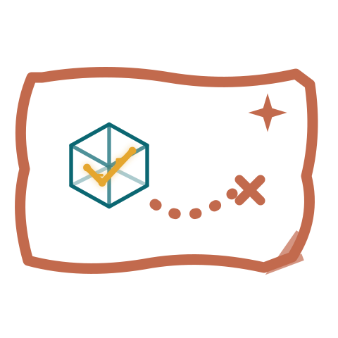

# Questline

**Build-your-own-adventure engine — real d20 mechanics, an AI Dungeon Master, one file.**

Questline is Bastion Fold's adventure engine: a single-file (`QUESTLINE.html`)
dice-driven text adventure where a deterministic engine owns HP, inventory,
stats, and d20 rolls, and an AI Dungeon Master runs the world around them.
Five hand-crafted offline campaigns ship with it (*Ghost in the Hull*,
*The Last Archivist*, *The Clockwork Deep*, *Generation Ship*, and
*The Reality Glitch*), and live AI play is metered through the shared
entertainment entitlement system.

This repository is Questline's **public face** (announcements and website
content). Source code currently lives in the private
`Alexander-Sorrell-IT/questline` repo and migrates to the private
`BastionFold/questline-engine` repo when that move is scheduled;
`BastionFold/questline-system` ties the three together.

- On the site: https://www.bastion-fold-site.workers.dev/entertainment/questline/
- Join the waitlist there to lock founding pricing at launch.
